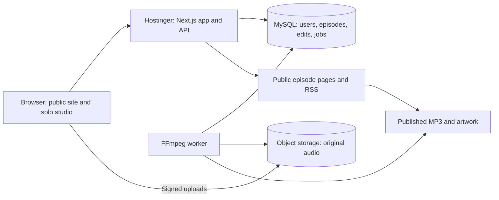

# Godly Homes deployment and recording suite plan

Reviewed November 2, 2026. The review below describes the original prototypes; see the implementation update for the current local MVP. Production infrastructure has not been changed.

Implementation update (November 2, 2026): the local MVP is now in `src/` and `server/`, with React/Vite, Express, MySQL SQL migrations, a solo recorder, local recovery, persistent server-volume audio, an FFmpeg worker and real publishing/RSS. The original review below records the starting state. See `README.md` for the implemented scope, setup, verification and remaining production acceptance checks. Production infrastructure and DNS remain unchanged. The implementation uses Express rather than Next.js, SQL migrations rather than Prisma, and persistent VPS media rather than object storage for the first release.

Confirmed scope: **godlyhomes.com**, **solo audio recording for the first release**. The recording suite is part of the website.

Read-only Hostinger inventory confirms `godlyhomes.com` already exists as an enabled website, detected as type `other`. The same hosting account has four websites detected as Node.js. The VPS inventory returned no instances. These results do not establish the exact subscription tier, remaining application capacity, database availability or contents of the current Godly Homes website; verify those before choosing infrastructure or replacing anything.

## Project review

The workspace contains two standalone React components: `GodlyHomesHomepage.jsx` and `GodlyHomesPodcastStudio.jsx`. There is no package manifest, app entry point, router, Tailwind setup, backend, database schema, migration system, or test/build configuration. This is a prototype foundation rather than a deployable application. Findings below are from source inspection; no application build or browser test is currently possible using the project as provided.

| Area | Current behavior | Required for launch |
| --- | --- | --- |
| Homepage | Responsive sections, resource filters, sample episodes | Real content, working navigation, metadata, accessible pages |
| Podcast player | Timer simulates progress; no episode audio playback | HTML audio player backed by published media |
| Newsletter | Validates an email and displays “Guide sent”; no request is sent | Subscriber persistence, email delivery, consent/unsubscribe flow, truthful status |
| Studio authentication | Any syntactically valid email and nonempty password signs in | Server authentication and authorization on every private endpoint |
| Recording | Microphone selection, level meter, one-second MediaRecorder events | Durable local backup, acknowledged uploads, interruption recovery |
| Editing | Trim, split, reorder, fades, gain, synthesized sound library and music ducking | Persist source assets and versioned edit instructions |
| Storage | Episodes and decoded audio live in React memory | MySQL metadata plus persistent media storage |
| Rendering | Whole episode rendered in browser memory | Queued server rendering for dependable long episodes |
| Publishing | Generates a temporary browser WAV URL and sample RSS item | Durable MP3, public episode page, complete RSS feed |

Specific launch blockers:

- `GodlyHomesPodcastStudio.jsx:296`: sign-in does not authenticate a user.
- `GodlyHomesPodcastStudio.jsx:396`: chunks are collected in memory, with no upload or recovery storage. Switching views while recording also needs explicit stop/finalize behavior.
- `GodlyHomesPodcastStudio.jsx:129`: full decoded audio and final render use browser memory. A one-hour stereo 44.1 kHz float buffer alone is about 1.27 GB before source buffers and WAV export.
- `GodlyHomesPodcastStudio.jsx:178`: RMS-based normalization is an approximation and does not measure LUFS or true peak.
- `GodlyHomesPodcastStudio.jsx:682`: publishing generates a WAV, but its RSS enclosure claims an MP3 at a hard-coded URL. The enclosure length is the WAV size. No file is uploaded or feed updated.
- `GodlyHomesPodcastStudio.jsx:697`: production XML must be generated safely, including descriptions containing `]]>`, stable GUIDs, namespaces and channel metadata.
- `GodlyHomesPodcastStudio.jsx:807`: “published/imported” episodes are fixtures, not an actual feed import.
- `GodlyHomesHomepage.jsx:249` and `:380`: player and newsletter success are simulated. Placeholder links and sample audience/rating claims need real destinations and verified content.

## Hosting decision

**Proposed default: Hostinger VPS for the web app, MySQL and an FFmpeg worker, with S3-compatible object storage for media.** This supports a self-contained processing service and future expansion. VPS administration, patching and backups must be owned as part of the deployment. Choose the actual VPS size after checking existing resources and measuring a representative long recording; do not purchase based on a guessed capacity.

Alternative: Hostinger Business/Cloud managed Node.js hosting for the app and its MySQL database, with a separately hosted render worker. This reduces web-server administration but introduces a second compute service. Hostinger documents a 120-second request timeout and no inbound WebSockets or always-running queue workers on managed Web/Cloud Node.js hosting. These restrictions make synchronous full-episode rendering unsuitable. [Hostinger Node.js limits](https://www.hostinger.com/support/hostinger-node-js-limits-for-web-and-cloud-plans/)

Hostinger supports React, Next.js and Express deployment on eligible managed plans. [Deployment documentation](https://www.hostinger.com/support/how-to-deploy-a-nodejs-website-in-hostinger/)

### Proposed application structure

- Next.js with React and Tailwind: reuse the existing designs, add public pages and a protected `/studio` area.
- Server API and MySQL persistence through Prisma migrations; confirm compatible MySQL/runtime versions before implementation.
- A separate Node.js worker running FFmpeg, initially claiming durable jobs from MySQL. Redis is unnecessary for the initial solo workflow.
- Object storage with private originals and public published exports. MySQL holds object keys, checksums, metadata and edit instructions; audio files are not stored in database rows.
- On a VPS: reverse proxy with HTTPS, application service, private MySQL service and worker, deployed as versioned services. Keep temporary render files outside application releases and clean them after jobs complete.

Use `godlyhomes.com` as the canonical site, redirect `www`, and keep `/studio` under the same origin. A media subdomain is optional after storage/CDN selection. Use `staging.godlyhomes.com` with separate data and private access before production. Inspect existing DNS, mail records and live content before planning cutover.

## MySQL data design

| Table | Main purpose and fields |
| --- | --- |
| `users` | ID, unique email, password hash, role, timestamps |
| `sessions` | Hashed session token, user ID, expiry, revocation |
| `shows` | Title, description, owner/contact, artwork asset, language, category, explicit flag |
| `episodes` | Show ID, title, unique per-show slug, episode number, notes, draft/published state, published revision, timestamps |
| `assets` | Owner, object key, original filename, MIME/container/codec, byte size, checksum, duration, sample rate, channels, upload state |
| `recording_sessions` | Episode/user IDs, recorder MIME type, state, start/stop times |
| `recording_chunks` | Session ID, sequence, object key, checksum, byte size, acknowledged status |
| `episode_revisions` | Episode ID, version, immutable snapshot of arrangement and mix settings |
| `segments` | Revision ID, source asset ID, order, source in/out times, fades and gain |
| `render_jobs` | Revision ID, state, attempt count, lease expiry, progress, error, output asset ID |
| `publications` | Episode/revision/output IDs, stable GUID, publication time and enclosure metadata |
| `subscribers` | Unique email, consent time, confirmation/unsubscribe state |

Use InnoDB, `utf8mb4`, UTC timestamps, foreign keys and indexes for episode listings and job claims. Add uniqueness on recording session plus chunk sequence for safe retries. Protect revision updates against concurrent edits. A retry must not create a duplicate publication. Decide the precise schema in implementation rather than importing a speculative SQL file now.

Database credentials stay on the server. Browser clients use authenticated APIs. Configure a restricted application database user and separate migration access. For managed Hostinger Node.js/MySQL, Hostinger specifies `127.0.0.1` as the local database host; a VPS container deployment instead uses its private database service hostname. [MySQL connection documentation](https://www.hostinger.com/support/connecting-a-hostinger-mysql-database-to-a-node-js-application/)

## Solo recording suite

Primary flow: **Create episode → Check microphone → Record takes → Arrange and edit → Preview → Render → Review → Publish.**

1. **Episode dashboard:** drafts, recovery-needed sessions, rendering progress and published episodes. Real saved timestamps and errors.
2. **Microphone check:** device selection, permission explanation, input meter and short test playback. Probe supported recording formats and show actionable device/browser errors.
3. **Record:** start, pause/resume, stop, elapsed time, markers and clear backup/upload status. Protect active recordings when navigating. Finalize recording before releasing the microphone or changing views.
4. **Recovery:** write chunks to IndexedDB as they arrive, upload in sequence with checksums and retries, and reconcile acknowledgments after reconnect. Offer local rescue download when storage/upload fails. Local browser storage has limits and can be evicted; surface failures. MediaRecorder timeslices are approximate, and individual chunks are not guaranteed independently decodable: preserve ordering and assemble each session before decoding. [MediaRecorder events](https://developer.mozilla.org/en-US/docs/Web/API/MediaRecorder/dataavailable_event)
5. **Editing:** reuse trim, split, reorder, fades, volume and music ducking. Store edits as metadata referencing immutable originals. Add undo/redo and autosave status. Generate waveform peaks for large assets instead of decoding an entire episode merely to display it.
6. **Render:** submit an immutable revision to a background job and poll status. Worker leases jobs, retries recoverable failures, validates source files, mixes edits/music, measures loudness and exports MP3 plus optional WAV master. Start with one render at a time until measured capacity supports more. Keep originals for re-editing.
7. **Review and publish:** listen to the completed file, enter title/notes/artwork, then publish deliberately. Proposed mastering targets are -16 LUFS stereo or -19 LUFS mono with a -1 dBTP ceiling; verify measured output and listening quality. No public publication before a valid export exists.
8. **Distribution:** generate a complete RSS channel from published records with stable GUIDs, real enclosure URLs, exact MP3 byte lengths, artwork and show metadata. Support playback seeking on media delivery. Podcast directory submission is a separate setup step; publishing a feed does not automatically create directory listings.

Initial release excludes remote guest calls, video recording, live broadcasting, transcription and payments. Shop/community expansion can follow the reliable public site and solo workflow.

## Delivery phases and acceptance checks

| Phase | Deliverable | Completion evidence |
| --- | --- | --- |
| 1. App foundation | Runnable application, shared theme/components, public routes and protected studio shell | Clean install and production build; homepage and studio load on mobile/desktop |
| 2. Identity and persistence | MySQL migrations, real login/roles, episode CRUD and asset APIs | Unauthorized requests fail; drafts and ownership survive sign-out/reload |
| 3. Recording and recovery | Durable chunks, resumed uploads, saved takes and persisted editing | A representative 60-minute session, refresh, offline/reconnect and denied microphone permission handled without falsely reporting saved audio |
| 4. Rendering and publishing | Worker, progress/retries, MP3/WAV, real player, RSS and public episode pages | Measured export quality; retry without duplicate publication; published playback/seek works and draft media stays private |
| 5. Staging and production | Hostinger deployment, domain/HTTPS, backups, monitoring and rollback | Restore database plus media; restart during job and recover; smoke-test production after DNS cutover |

Proposed API groups: `/api/auth/*`, `/api/episodes`, `/api/episodes/:id/revisions`, `/api/recording-sessions`, upload/acknowledgment endpoints, `/api/render-jobs`, `/api/episodes/:id/publish`, public episode endpoints and `/podcast/feed.xml`. Validate ownership, limits and input server-side; use secure HTTP-only session cookies, CSRF protection for mutations and rate limiting for login/uploads.

## Hostinger rollout sequence

1. Verify existing hosting/VPS resources, target domain ownership, current site and DNS/mail configuration. Choose VPS or managed hosting plus external worker. Confirm media storage provider and budget.
2. Build and verify locally before changing production. Pin dependencies and provide documented install/build/start/migrate commands, health checks and example environment variable names without secrets.
3. Provision isolated staging app/database/storage and configure HTTPS. Database and worker ports remain private.
4. Deploy a versioned build, run migrations, create the initial administrator securely and complete the acceptance checks above. Back up the database and media and perform a restore drill.
5. Inventory any current website content, existing subscribers and podcast feed. Preserve canonical URLs and GUIDs if an existing feed is being migrated.
6. Back up current production, deploy the verified release and apply reviewed migrations. Move DNS only after staging acceptance and origin readiness. Preserve MX/SPF/DKIM/DMARC records.
7. Verify HTTPS, login, recording, saving, rendering, public playback, RSS, newsletter delivery and error reporting. Monitor disk, memory, storage growth, render queue age and failed uploads.
8. Keep the previous application release and DNS values available. Roll back code to a schema-compatible release; use backward-compatible migrations where possible. Database restores require a separate recovery decision because they can lose newer writes.

Pending decisions: existing Hostinger plan/resources, media storage provider, expected recording length/weekly volume, initial studio administrators, and whether a live site or podcast feed already needs migration. No paid resources or production changes are part of this planning pass.
